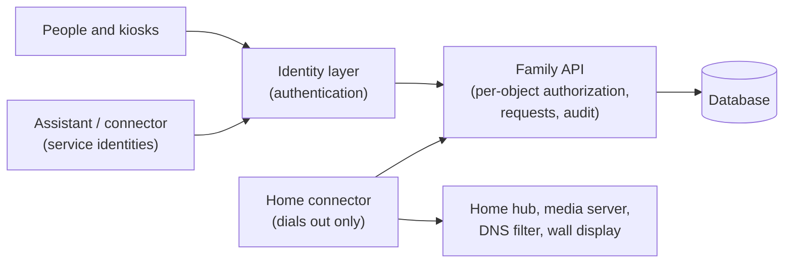

# family-ops-template

**A self-hosted household requests and approvals API, plus a broader Family Ops blueprint.**

Version 0.2.0 runs the request → parent approval → recorded outcome workflow with persistent storage, individual authentication and an audit trail. [Self-hosting quickstart](docs/self-hosting.md) · [Runtime OpenAPI](openapi/runtime.yaml) · [Release notes](RELEASE-NOTES.md).

The original 74-operation design covers calendar, chores, meals, activities, home automation, media, gaming and more. **Those broader domains remain a blueprint, not implemented services.** No real household data is included. No public hosted instance or universal parental-control enforcement is claimed.

## Broader blueprint architecture

The diagram below includes planned components, not just the v0.2.0 runtime.



Full diagram and component choices: [docs/architecture.md](docs/architecture.md).

## What is in here

- `server/`: runnable Flask/Gunicorn request service and operator/client commands.
- `compose.yaml` and `Dockerfile`: private self-host deployment.
- `openapi/runtime.yaml`: implemented API surface only.
- `tests/`: authorization, workflow, persistence and backup tests.

| Path | What |
|---|---|
| [`openapi/openapi.yaml`](openapi/openapi.yaml) | The broader design: 74 operations across calendar, chores, meals, activities, house, media, gaming, requests, apps, devices and audit, plus household and connector support routes |
| [`model/roles.json`](model/roles.json) | Role matrix (source of truth); rendered in [docs/roles.md](docs/roles.md) |
| [`model/request-states.json`](model/request-states.json) | Request lifecycle, either and both decision policies |
| [`scripts/request-reducer.mjs`](scripts/request-reducer.mjs) | Executable reference for the request state machine |
| [`examples/`](examples) | Synthetic household, routing rules, app catalog with opt-ins and suggestions, request scenarios |
| [`docs/`](docs) | Architecture, roles, requests, security model, self-service, gaming platforms, implementation guide |

## Design rules

1. **Authentication is not authorization.** The identity layer says who you are; the API checks every
   object (ownership, hidden items, kiosk binding, request deciders, legal state transitions).
2. **No service identity can act as a parent.** Parents decide in their own session; the only other path
   is an opt-in quick reply signed by the messaging platform and checked by the API, which no household
   service can produce.
3. **No inbound ports at home.** A connector dials out; adults administer home services over a private
   mesh VPN.
4. **The hub owns devices.** The API sends typed intents to a home-automation hub, never raw device calls.
5. **Profiles start disabled, apps are opt-in, kids' data stays private.**
6. **Never claim enforcement you do not have.** Gaming limits are automated only where a platform allows
   it; elsewhere the parent gets a checklist ([docs/gaming-platforms.md](docs/gaming-platforms.md)).

## Validate

```sh
npm ci --ignore-scripts
npm run check
```

`npm run check` runs Redocly lint on the spec, checks every operation's `x-allowed-roles` against the role
matrix, checks the docs table against the matrix, validates the examples against the spec's schemas,
replays the request scenarios through the reducer, and runs a generic privacy scan. CI runs the same, plus
gitleaks over the full history, OSV-Scanner and CodeQL.

## Extend the blueprint

Start with [docs/implementation-guide.md](docs/implementation-guide.md). Suggested order: requests inbox,
calendar, chores and lists first; the home hub and connector next; gaming and device schedules last.

## License

MIT. See [LICENSE](LICENSE).
