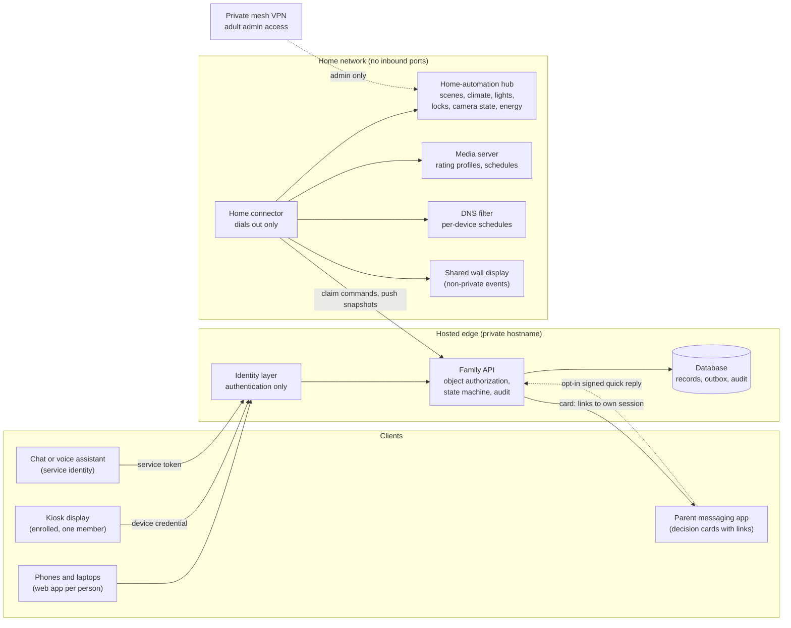

# Architecture

**Blueprint. Not deployed.** This is one way to build a private household API. Swap any box for the
equivalent you already run.



ASCII version:

```
 CLIENTS                         HOSTED EDGE (private hostname)              HOME NETWORK (no inbound ports)
 Phones / laptops ─────┐
 Kiosk (device cred) ──┼──► Identity layer ──► Family API ──► Database          Home connector (dials out)
 Assistant (svc token)─┘    (authn only)       (object authz,  (records,          │  ▲ claim commands,
                                               state machine,   outbox, audit) ◄──┘  │ push snapshots
 Parent messaging app ◄── card with links ─────┘                                     ├──► Home-automation hub
 Parent messaging app ··· opt-in signed quick reply ···► API (no service between)    ├──► Media server
                                                                                     ├──► DNS filter
 Private mesh VPN ····· adult admin only ·····► hub                                  └──► Shared wall display
```

## The five rules

1. **Authentication is not authorization.** The identity layer says who is calling. The API decides,
   per object, what they may see and change. See [security-model.md](security-model.md).
2. **No inbound ports at home.** The connector dials out to claim commands (`/connector/commands`) and
   pushes state snapshots. Adults reach home services for admin over a private mesh VPN, never a public
   tunnel.
3. **The hub owns devices.** The API sends typed intents ("run scene bedtime", "zone 2 to 20 C"), never
   raw device calls. Integrations, device code and on-device automations live in the hub.
4. **One record, many views.** An activity is a calendar event with a `kind`; a bonus-time ask is a
   request with a `kind`. Labels route records to views; records are never copied.
5. **State lives in the database, not in an assistant.** Assistants read and write through the API at
   the moment of use and remember nothing between turns.

## Components and choices

| Component | Role | Suggested options | Exit |
|---|---|---|---|
| Identity layer | Login per person, device credentials, service tokens | An identity-aware proxy or any OIDC provider | Standard JWTs; swap provider |
| Family API | Routes in `openapi/openapi.yaml` | Any serverless runtime or a small container | Spec-first; port the handlers |
| Database | Records, command outbox, audit | SQLite-compatible or Postgres | SQL export |
| Home connector | Outbound pull, snapshots | A small script or service on an always-on home machine | Plain code |
| Home-automation hub | Devices and automations | Home Assistant | Local config and backups |
| Media server | Kid-safe libraries and schedules | Jellyfin (or Plex with managed users) | Media stays as files |
| DNS filter | Per-device network schedules | AdGuard Home or Pi-hole | Drop-in alternatives |
| Wall display | Shared calendar | Any display that reads an ICS feed | ICS is a standard |
| Messaging app | Decision cards for parents | Any bot platform; quick reply needs one that signs callbacks | Cards only link to the web inbox, which stays the main path |
