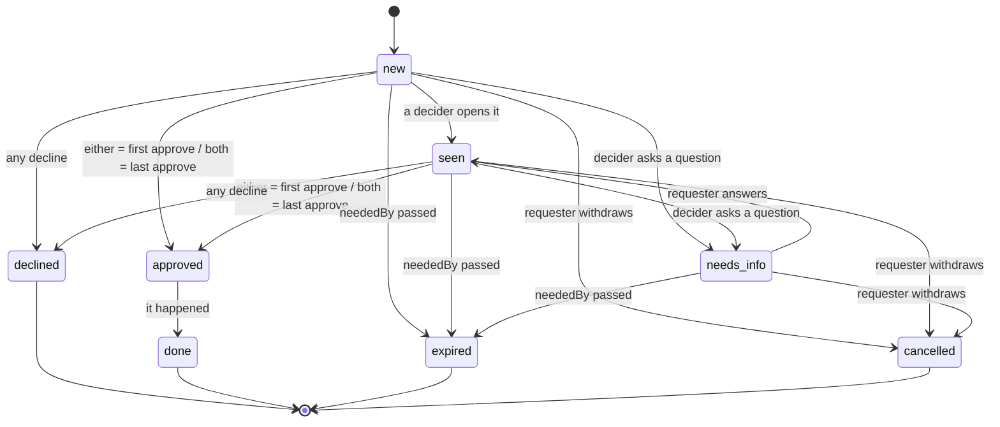

# The family inbox: requests

Anyone in the household can ask for something: a purchase, a lift somewhere, permission, a repair, an
idea, more play time, a new app. Each ask goes to the parents who handle that kind of ask, and they settle
it under one of two policies, **either** or **both**. Machine-readable model:
[`model/request-states.json`](../model/request-states.json). Executable reference:
[`scripts/request-reducer.mjs`](../scripts/request-reducer.mjs), replayed by `npm run check` against
[`examples/request-scenarios.json`](../examples/request-scenarios.json).

## Routing

Routing rules (`GET/PUT /requests/routing-rules`) turn "who asked, and what kind" into a list of deciders
and a policy. The first matching rule wins; the default covers the rest. Example
([`examples/routing-rules.json`](../examples/routing-rules.json)):

| From | Kind | Deciders | Policy |
|---|---|---|---|
| teen | ride | Parent A, Parent B | either: whichever parent is free takes it |
| teen | buy | Parent A, Parent B | both |
| child | permission | Parent A, Parent B | both |
| Parent A | any | Parent B | either |
| Parent B | any | Parent A | either |
| everyone else | any | Parent A, Parent B | either |

The deciders are copied onto the request at creation. Changing the rules later leaves open requests
alone. Nobody decides their own request, and nobody named in `hiddenFrom` is a decider.

## Policies

| Policy | Approved when | Declined when |
|---|---|---|
| either | one decider approves | one decider declines |
| both | all deciders have approved | any decider declines |

A decider gives one verdict per request: `approve`, `decline` or `needs_info`. Giving a second one returns
409. `needs_info` holds the request until the person who asked replies.

## How a parent decides

1. **Default: in their own signed-in session** (`POST /requests/{id}/decisions`). Cards sent to a parent's
   phone carry links that open this page. No assistant, connector or other service can record a verdict.
2. **Opt-in quick reply** (`POST /requests/{id}/channel-decisions`, off unless the household turns it on).
   The messaging platform sends the button press straight to the API, signed. The API checks the
   signature itself, matches the platform's sender id to the parent's enrolled account, and requires a
   one-time value minted for that request, that parent and that exact verdict, so a Decline press cannot
   be turned into Approve. Household services cannot call this route. Anyone who controls the parent's
   messaging account can still press the buttons, so leave quick reply off for asks you treat as
   high-stakes.

## Notifications (choose your own values)

- A new request alerts each decider on the channel they picked and appears in the web inbox.
- Pick quiet hours, and pick how soon a `neededBy` has to be before a request breaks through them.
- Pick a reminder interval for unanswered requests. Once `neededBy` passes, the request expires.
- The person who asked follows progress on their own page. On a kiosk, the status appears as a picture.

## Kinds

`app`, `bonus-time`, `buy`, `fix`, `idea`, `media`, `permission`, `picture` (a kiosk card; the picture
says what is wanted), `ride`, `surprise` (use `hiddenFrom`).
